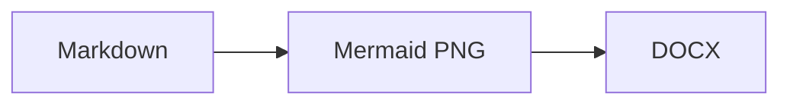

# Mark→Word

A small Markdown editor that converts your writing to an editable `.docx` file with FastAPI, React, and Pandoc. It supports inline/display LaTeX (`$x^2$`, `\\(x^2\\)`, `$$x^2$$`, `\\[x^2\\]`), pipe tables, raw HTML tables, and Mermaid diagrams.

## Requirements

- Python 3.12+
- [uv](https://docs.astral.sh/uv/)
- Node.js 18+
- [Pandoc](https://pandoc.org/installing.html) installed and available on your PATH
- Mermaid CLI installed and available on your PATH: `npm install --global @mermaid-js/mermaid-cli`

## Run in development

In one terminal:

```powershell
uv sync
uv run uvicorn main:app --reload
```

In another terminal:

```powershell
cd frontend
npm install
npm run dev
```

Open http://localhost:5173. The Vite server proxies `/api` requests to FastAPI.

## Run as one production app

```powershell
cd frontend
npm install
npm run build
cd ..
uv run uvicorn main:app
```

Open http://127.0.0.1:8000. The FastAPI app serves `frontend/dist` when it exists.

The supplied `reference.docx` is used automatically when it is present. Temporary Markdown and DOCX files are created under `.tmp` and the generated DOCX is removed after download.

Use a fenced Mermaid block in the editor:

````markdown

````

The browser shows the live SVG diagram, while the DOCX contains the generated PNG image.

## Accounts and security

The app requires an account. Registering uses Google Identity Services to verify the user's Gmail address, then asks the user to create a local password. After registration, users log in with their Gmail address and that password.

Create a Google OAuth web client ID, then set it in both places before running the app:

```powershell
$env:GOOGLE_CLIENT_ID="your-google-client-id.apps.googleusercontent.com"
cd frontend
$env:VITE_GOOGLE_CLIENT_ID="your-google-client-id.apps.googleusercontent.com"
```

Registering the first account makes it the administrator; later accounts are regular users. Each user has a separate notes list. The administrator can open the Admin panel to list, block/unblock, or delete other users and their notes.

Sessions use random HttpOnly cookies and server-side expiry records. Passwords are stored using PBKDF2-SHA256 hashes. For HTTPS deployments set `MDTODOCX_COOKIE_SECURE=1` and terminate TLS at your reverse proxy.
