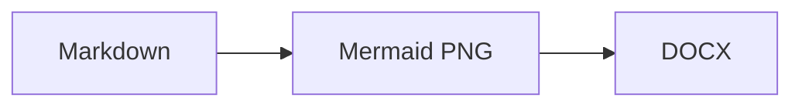
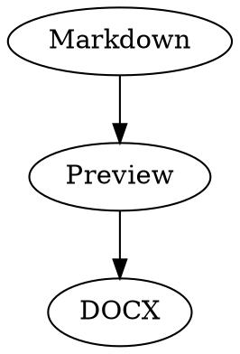

# MarkDoc 1.0.0

A small Markdown editor that converts your writing to an editable `.docx` file with FastAPI, React, and Pandoc. It supports inline/display LaTeX (`$x^2$`, `\\(x^2\\)`, `$$x^2$$`, `\\[x^2\\]`), pipe tables, raw HTML tables, Mermaid diagrams, Graphviz diagrams, and TikZ/LaTeX diagrams.

## Requirements

- Python 3.12+
- [uv](https://docs.astral.sh/uv/)
- Node.js 22.13+ (required by Mermaid CLI 12)
- [Pandoc](https://pandoc.org/installing.html) installed and available on your PATH
- Mermaid CLI 12 installed and available on your PATH: `npm install --global @mermaid-js/mermaid-cli@12`
- Graphviz installed with the `dot` command available on your PATH
- TeX Live (with TikZ/pgfplots) installed with `xelatex` on your PATH: `apt install texlive-latex-extra texlive-pictures texlive-xetex`
- Poppler installed with the `pdftoppm` command available on your PATH: `apt install poppler-utils`

## Run in development

In one terminal:

```powershell
uv sync
uv run uvicorn main:app --reload
```

In another terminal:

```powershell
cd frontend
npm install
npm run dev
```

Open http://localhost:5173. The Vite server proxies `/api` requests to FastAPI.

## Run as one production app

```powershell
cd frontend
npm install
npm run build
cd ..
uv run uvicorn main:app
```

Open http://127.0.0.1:8000. The FastAPI app serves `frontend/dist` when it exists.

The supplied `reference.docx` is used automatically when it is present. Temporary Markdown and DOCX files are created under `.tmp` and the generated DOCX is removed after download.

## Windows desktop app

The desktop shell uses Tauri and a Rust backend while serving the existing frontend unchanged. It uses a local SQLite database for its single local account and notes. The NSIS installer is configured to install the `references/` templates automatically. The Windows app icon is generated from `frontend/public/favicon.svg`.

Build prerequisites are Rust, Node.js/npm, the Visual Studio C++ build tools and Windows SDK, and WebView2. Build both Windows installer formats with:

```powershell
cargo install tauri-cli --version 2.12.4 --locked
cargo tauri dev
cargo tauri build --bundles nsis,msi
```

The release artifacts are written to `src-tauri/target/release/bundle/nsis/` and `src-tauri/target/release/bundle/msi/`.

Both NSIS (`.exe`) and WiX (`.msi`) installers run `src-tauri/resources/install-dependencies.ps1` after copying the app: NSIS uses its post-install hook and MSI uses a WiX custom action. The script reuses Pandoc and TeX tools found on `PATH` or in standard Windows install locations; if they are missing, it downloads Pandoc (SHA-256 verified against GitHub release metadata) and/or a basic portable MiKTeX installation into MarkDoc's installation directory. MiKTeX can download additional TeX packages when TikZ exports need them. The setup script also reuses Graphviz and Mermaid tools when available, or downloads Graphviz, Node.js, Mermaid CLI, and Chromium into MarkDoc's installation directory. Downloads are verified against upstream SHA-256 metadata where provided. Setup therefore requires an internet connection when WebView2 or any required runtime is not already available. Runtime dependencies are no longer copied into the installer during the build.

The desktop backend checks app-local tools first, then falls back to tools available on `PATH`. Mermaid can use an existing Chromium, Chrome, or Edge installation; otherwise setup downloads Chromium alongside the app-local Mermaid runtime.

The dependency setup writes `install-dependencies.log` in the installation folder. It needs internet access when Pandoc, MiKTeX, Graphviz, Mermaid, Node.js, or Chromium are not already available. MSI continues if dependency setup fails; check the log and ensure the export dependencies are installed before relying on export.

## Releases

The current stable release is **1.0.0**. Download the Windows installers from [GitHub Releases](https://github.com/Prathat2006/mdtodocx/releases/latest):

- `MarkDoc_1.0.0_x64-setup.exe` — NSIS installer.
- `MarkDoc_1.0.0_x64_en-US.msi` — Windows Installer package.

Release notes and version history are in [CHANGELOG.md](CHANGELOG.md). Release tags use the `vMAJOR.MINOR.PATCH` format (for example, `v1.0.0`). The product version is kept in sync across `pyproject.toml`, `frontend/package.json`, `src-tauri/Cargo.toml`, and `src-tauri/tauri.conf.json`.

Use a fenced Mermaid block in the editor:

````markdown

````

The browser shows the live SVG diagram, while the DOCX contains the generated PNG image.

Use a fenced `dot` or `graphviz` block for Graphviz diagrams:

````markdown

````

The browser renders Graphviz as an SVG image; DOCX export renders a 300-DPI PNG. Both use Graphviz's default `dot` layout engine, so nodes and edges keep the same arrangement. The preview remains sharper because SVG is vector-based while the DOCX image is raster-based.

Use a fenced `tikz`, `latex-diagram`, or `pgfplots` block for LaTeX/TikZ diagrams (the content may also be a complete LaTeX document with its own `\documentclass`):

````markdown
```tikz
\begin{tikzpicture}
  \draw[thick,fill=teal!20] (0,0) rectangle (2,1) node[midway] {TikZ};
  \draw[->] (2.2,0.5) -- (4,0.5) node[midway,above] {DOCX};
\end{tikzpicture}
```
````

The browser shows the compiled diagram (rendered by the same server-side pdflatex engine used for export), while the DOCX contains a generated PNG image. Compile errors are shown in the preview and reported during export.

TikZ diagrams must be self-contained: `\input`/`\include` of external `.tex` files is not supported, so paste the complete `tikzpicture` code into the fence. Everything from the `pgf`, `pgfplots`, and `pgfplotstable` packages that ships with TeX Live is available.

## Accounts and security

The app requires an account. Enter an email address first; the app checks whether it is already registered in the local database. Existing users are asked for their password, while new users can create an account. Registration is idempotent: an existing email is never duplicated, and submitting its correct password signs the user in.

Registering the first account makes it the administrator; later accounts are regular users. Each user has a separate notes list. The administrator can open the Admin panel to list, block/unblock, or delete other users and their notes.

Sessions use random HttpOnly cookies and server-side expiry records. Passwords are stored using PBKDF2-SHA256 hashes. For HTTPS deployments set `MDTODOCX_COOKIE_SECURE=1` and terminate TLS at your reverse proxy.
